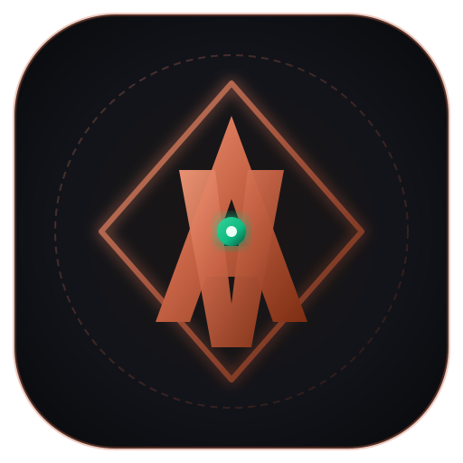

# 🏛️ Alina Studio OS v3.3
### *LMNJDRS 3D Previz-to-Higgsfield Suite, Double-Registry Vault & Episodic Cinema*

> **Suite de Producción Virtual Métrica 1:1 (Three.js WebGL2)** para **Alina Van Dijk**, con pases multipass nativos (`Beauty PBR CoC`, `Depth 16-bit`, `Camera Normals`, `Semantic Mask 7-ID`, `OpenPose`), Bóveda de 32 Objetos, Grafo Nodal 2D (*Sequencer × Fusion*) y Consejo de 8 Jefes de Departamento.

🌐 **Aplicación en Vivo (GitHub Pages):**
👉 **[https://danisantanderurrutia-coder.github.io/alina-studio-os/](https://danisantanderurrutia-coder.github.io/alina-studio-os/)**

---

## 🔗 Enlaces Directos & Slugs Oficiales

### Menú Principal (5 Espacios de Trabajo)
- **Plató 3D:** [`#plato`](https://danisantanderurrutia-coder.github.io/alina-studio-os/#plato)
- **Estudio de Prompts (Flux + Higgsfield):** [`#prompts`](https://danisantanderurrutia-coder.github.io/alina-studio-os/#prompts)
- **Bóveda de Objetos (32 Activos Beauty + Depth):** [`#objetos`](https://danisantanderurrutia-coder.github.io/alina-studio-os/#objetos)
- **Cine & Capítulos:** [`#cine`](https://danisantanderurrutia-coder.github.io/alina-studio-os/#cine)
- **Consejo de Asesores (8 HoDs):** [`#asesores`](https://danisantanderurrutia-coder.github.io/alina-studio-os/#asesores)

### Sub-secciones de Cine, Grafo & Consejo
- **Capítulos & Historia:** [`#capitulos`](https://danisantanderurrutia-coder.github.io/alina-studio-os/#capitulos) (`#capitulo-1` a `#capitulo-4`)
- **Grafo Blueprint 2D (Sequencer × Fusion):** [`#blueprint`](https://danisantanderurrutia-coder.github.io/alina-studio-os/#blueprint)
- **Director de Fotografía & Animatic:** [`#director`](https://danisantanderurrutia-coder.github.io/alina-studio-os/#director)
- **Biblia de Alina & Doctrina Zero-Waste:** [`#biblia`](https://danisantanderurrutia-coder.github.io/alina-studio-os/#biblia)
- **Armario Cápsula & Perchero 3D (7 Looks):** [`#vestuario`](https://danisantanderurrutia-coder.github.io/alina-studio-os/#vestuario)
- **Los 8 Jefes de Departamento:** [`#hods`](https://danisantanderurrutia-coder.github.io/alina-studio-os/#hods)

### Niveles Arquitectónicos y Spots 3D
- **Vistas Globales:** [`#casa-de-munecas`](https://danisantanderurrutia-coder.github.io/alina-studio-os/#casa-de-munecas) · [`#exterior`](https://danisantanderurrutia-coder.github.io/alina-studio-os/#exterior)
- **Piso 4 (Rooftop Penthouse):** [`#piso-4`](https://danisantanderurrutia-coder.github.io/alina-studio-os/#piso-4) · [`#spot-pool`](https://danisantanderurrutia-coder.github.io/alina-studio-os/#spot-pool) · [`#spot-bar`](https://danisantanderurrutia-coder.github.io/alina-studio-os/#spot-bar)
- **Piso 3 (The Mind Sanctuary):** [`#piso-3`](https://danisantanderurrutia-coder.github.io/alina-studio-os/#piso-3) · [`#spot-podcast`](https://danisantanderurrutia-coder.github.io/alina-studio-os/#spot-podcast) · [`#spot-boudoir`](https://danisantanderurrutia-coder.github.io/alina-studio-os/#spot-boudoir)
- **Piso 2 (Residencia Privada):** [`#piso-2`](https://danisantanderurrutia-coder.github.io/alina-studio-os/#piso-2) · [`#spot-vanity`](https://danisantanderurrutia-coder.github.io/alina-studio-os/#spot-vanity) · [`#spot-bath`](https://danisantanderurrutia-coder.github.io/alina-studio-os/#spot-bath) · [`#spot-kitchen`](https://danisantanderurrutia-coder.github.io/alina-studio-os/#spot-kitchen) · [`#spot-suite`](https://danisantanderurrutia-coder.github.io/alina-studio-os/#spot-suite)
- **Piso 1 (Le Velvet Café):** [`#piso-1`](https://danisantanderurrutia-coder.github.io/alina-studio-os/#piso-1) · [`#spot-cafe`](https://danisantanderurrutia-coder.github.io/alina-studio-os/#spot-cafe) · [`#spot-walk-cafe`](https://danisantanderurrutia-coder.github.io/alina-studio-os/#spot-walk-cafe)
- **Planta Baja (Cabaret Nocturne):** [`#planta-baja`](https://danisantanderurrutia-coder.github.io/alina-studio-os/#planta-baja) · [`#spot-cabaret`](https://danisantanderurrutia-coder.github.io/alina-studio-os/#spot-cabaret) · [`#spot-parking`](https://danisantanderurrutia-coder.github.io/alina-studio-os/#spot-parking)

### Guía Técnica Interactiva (`📖 Guía`)
- [`#guia`](https://danisantanderurrutia-coder.github.io/alina-studio-os/#guia) · [`#guia-optica`](https://danisantanderurrutia-coder.github.io/alina-studio-os/#guia-optica) · [`#guia-camaras`](https://danisantanderurrutia-coder.github.io/alina-studio-os/#guia-camaras) · [`#guia-pases`](https://danisantanderurrutia-coder.github.io/alina-studio-os/#guia-pases) · [`#guia-regla-1-2`](https://danisantanderurrutia-coder.github.io/alina-studio-os/#guia-regla-1-2) · [`#guia-boveda`](https://danisantanderurrutia-coder.github.io/alina-studio-os/#guia-boveda) · [`#guia-errores`](https://danisantanderurrutia-coder.github.io/alina-studio-os/#guia-errores) · [`#guia-sequencer-fusion`](https://danisantanderurrutia-coder.github.io/alina-studio-os/#guia-sequencer-fusion)

---

© 2026 Manejadores (LMNJDRS) — Todos los derechos reservados.
